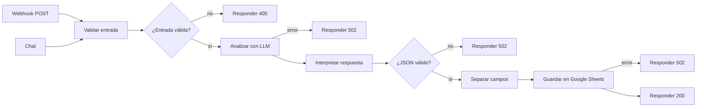

# Clasificador de vacantes con n8n

Recibe el texto de una vacante por webhook o por chat, extrae sus datos con un LLM local (Ollama) y los guarda en una fila de Google Sheets. Corre en tu máquina: el LLM no necesita clave de API ni tiene costo por uso.

## Flujo



## Cómo correrlo

Necesitas Docker. El modelo ocupa unos 2,5 GB.

1. Levanta n8n y Ollama, y descarga el modelo:

   ```bash
   docker compose up -d
   docker compose exec ollama ollama pull qwen3:4b
   ```

2. Abre `http://localhost:5678`, crea tu usuario e importa `workflow.json` (menú del flujo → *Import from File*).
3. Crea una hoja de Google con una pestaña llamada `Vacantes` y estos encabezados en la fila 1:

   ```text
   fecha | cargo | empresa | modalidad | nivel | requisitos_obligatorios | requisitos_deseables | resumen
   ```

   Los nombres deben coincidir exactamente, sin espacios al inicio ni al final. Si uno no coincide, el flujo responde 502 y no escribe la fila.

4. En el nodo **Guardar en Google Sheets**, crea la credencial de Google y reemplaza `REEMPLAZAR_CON_ID_DE_TU_HOJA` por el ID de tu hoja. Es el fragmento de la URL entre `/d/` y `/edit`.
5. Envía una vacante. Lo más directo es pulsar **Open chat** en el editor y pegar el texto. Para usar el webhook, publica el flujo y ejecuta:

   ```bash
   curl -X POST http://localhost:5678/webhook/vacante \
     -H "Content-Type: application/json" \
     -d @pruebas/vacante.json
   ```

Respuesta del webhook (la primera llamada tarda más porque carga el modelo en memoria):

```json
{
  "ok": true,
  "output": "Vacante guardada en Google Sheets.
Cargo: Analista de datos senior
...",
  "datos": {
    "fecha": "2026-11-05T22:04:23.033-05:00",
    "cargo": "Analista de datos senior",
    "empresa": "Globex SAS",
    "modalidad": "hibrida",
    "nivel": "senior",
    "requisitos_obligatorios": "5 anos de experiencia; SQL avanzado; Python",
    "requisitos_deseables": "Airflow; dbt",
    "resumen": "Analista de datos con 5 años de experiencia en SQL avanzado y Python."
  }
}
```

Para comprobar las respuestas de error, ejecuta `sh pruebas/errores.sh`.

## Errores

| Situación | Código | ¿Escribe fila? |
|---|---|---|
| `texto` falta, está vacío, no es texto o supera 20.000 caracteres | 400 | No |
| El LLM no responde (reintenta una vez) | 502 | No |
| El LLM devuelve JSON inválido o con campos incorrectos | 502 | No |
| Google Sheets falla | 502 | No |
| Todo correcto | 200 | Sí |

## Decisiones

- **Una sola ruta para el chat y el webhook.** Ambos entran por el mismo nodo de validación, así que comparten reglas y errores. El panel de chat del editor muestra los datos en JSON; el texto de `output` lo reciben el webhook y un chat público.
- **HTTP Request a Ollama en vez del nodo de modelo de chat.** La API permite pasar un esquema JSON en `format`, y el flujo exportado queda sin ninguna credencial del LLM.
- **Esquema y validación propia.** El esquema reduce las respuestas malformadas, pero no las descarta. El nodo *Interpretar respuesta* revisa de nuevo cada campo, para que una respuesta incorrecta termine en un 502 y no en una fila dañada.
- **`null` antes que inventar.** El prompt solo acepta datos explícitos. Al probarlo, la primera versión marcaba como `junior` una vacante que no indicaba el nivel; por eso el nivel ahora depende de lo que diga el texto o de los años de experiencia.
- **Celdas en modo `RAW`.** El texto de una vacante no es de confianza. Así, Google Sheets recibe la instrucción de guardar los valores sin interpretarlos como fórmulas. En las pruebas el modelo quitó el `=` antes de llegar a la hoja, por lo que este modo no se ha visto actuar con una fórmula real.
- **Error si una columna no coincide.** Por defecto, el nodo de Sheets crea columnas nuevas en silencio. Al probarlo con un encabezado que tenía un espacio al final, la fila quedó repartida en columnas equivocadas y aun así respondió 200. Ahora ese caso es un error visible.
- **Temperatura 0 y límite de entrada.** Las mismas pruebas dieron el mismo resultado en dos corridas seguidas, y el límite de caracteres evita que un texto largo se corte en silencio al superar el contexto del modelo.

## Limitaciones

- **Prompt injection:** el prompt le indica al modelo que ignore las instrucciones dentro de la vacante, pero no es una garantía. En una de dos pruebas, un texto malicioso logró alterar el campo `empresa`, aunque no los demás. Revisa los datos antes de usarlos para decidir algo.
- **Webhook sin autenticación:** está pensado para uso local. Antes de exponerlo a internet, configura la autenticación del nodo Webhook.
- **Modelo pequeño:** `qwen3:4b` es rápido y gratuito, pero menos preciso que un modelo más grande. En una prueba tomó la palabra "ficticia" como modalidad. Para cambiarlo, edita `model` en el nodo **Analizar con LLM**.

## Sin GPU NVIDIA

`compose.yml` corre Ollama en CPU, lo que funciona en cualquier equipo pero es más lento. Si tienes GPU NVIDIA, descomenta la sección `deploy` del archivo.
